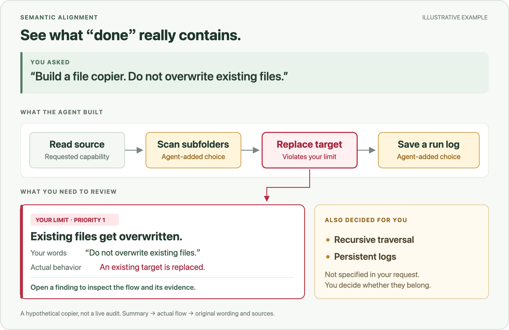

# Semantic Alignment

**Your agent says “done.”**
**You still don’t know what it skipped, changed, or decided for you.**

Semantic Alignment compares what you asked for with what was built, then shows the differences in a visual report—with **violations of your limits first**.

*Illustrative example. Added choices can be useful—the point is to let you see and judge them.*

## See the decisions behind the code

- **Spot violated limits.** See the exact user restriction, the behavior that violates it, and the evidence.
- **See what was missed or added.** Surface omitted requirements and added defaults, dependencies, checks, storage or interaction choices.
- **Skim first, inspect when needed.** Start with a difference summary, then open a finding to explore its flow, original wording and sources. Unverified behavior stays visible.

Use it to review a feature built by an agent, check a handoff, or pick up a project whose decisions have become hard to track.

## Try it on your next change

Install `SKILL.md`, `agents/`, `references/` and `assets/` together as the `semantic-alignment` skill using your agent’s supported installation mechanism. Point it at your project or change, then ask:

> Use semantic-alignment to check whether this matches my requirements. Show what you added or decided without me specifying it, and put violations of my constraints first.

Start from the conversation or existing requirements; you don’t need to prepare a semantic record first. For ongoing work, the Skill keeps current user agreements in the project’s designated Markdown document, or `SEMANTICS.md` by default.

You get a separate summary, an expandable HTML/SVG report and editable Markdown findings. Reports are local; generation uses Python 3. The agent makes the semantic judgments, and the templates handle presentation. Conclusions remain tied to the evidence actually checked.

[Skill instructions](SKILL.md) · [Checking method](references/audit-presentation.md) · [Report templates](references/template-usage.md)
